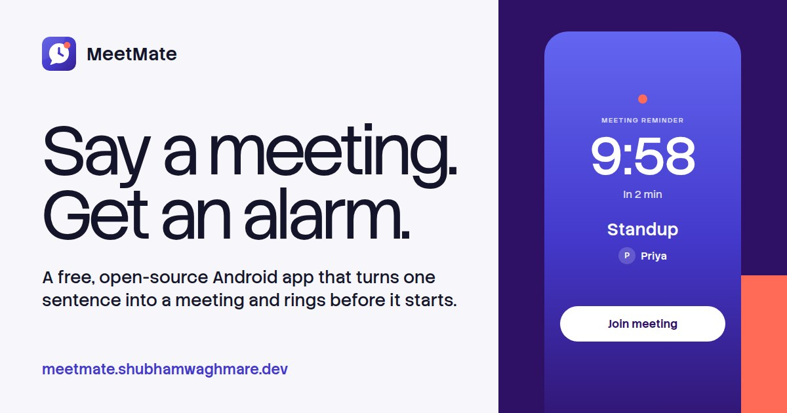

# MeetMate

**Say a meeting, get an alarm.** Type or say *"Standup with Priya every weekday at 10am"* and MeetMate fills in the title, person, date, time, repeat and meeting link, then rings like an alarm clock before the meeting starts, even on a locked phone.



**Website:** https://meetmate.shubhamwaghmare.dev (try the sentence parser in your browser)
**Download:** the signed APK is on the [Releases](https://github.com/ShubhamWaghmare52/MeetMate/releases) page. Android 8.0 or newer.

## What it does

- **One sentence in, a meeting out.** Understands people ("with Priya"), days ("tomorrow", "next Friday", "on 5 Nov", "31/12"), times ("at 3pm", "at 12.30", "at noon", "in 2 hours", "from 3 to 4pm"), repeats ("every weekday", "daily", "every Monday") and Meet, Zoom, Teams and Webex links, even when the keyboard autocorrects them to "meet. Google. Com/…". Voice input uses the phone's speech recognizer.
- **Rings like an alarm.** A full-screen alarm over the lock screen with Join meeting, Snooze 5 min and Dismiss. It plays on the alarm volume with vibration for up to a minute, then leaves a normal notification.
- **Join in one tap** from the card, the Next up card, the notification or the alarm screen.
- **Repeats:** daily, weekdays and weekly.
- **Reliable:** reminders are set again after a reboot, an app update, a time-zone change and a force-stop, and never ring twice. A home-screen card warns if notifications, exact alarms or the lock-screen alarm are turned off.
- **Extras:** home-screen widget, Quick Settings tile, launcher shortcuts, Add to Google Calendar, notes, categories, search, light and dark themes.
- **Accessible:** TalkBack reads each meeting as one sentence with Mark done and Delete actions; the layout holds at 200% text.
- **Private:** no account, no server, no ads, and no internet permission. Everything stays on the phone. Voice input goes through your phone's own speech app, which may use the network itself.

## Install

1. On your phone, download `MeetMate.apk` from the latest [release](https://github.com/ShubhamWaghmare52/MeetMate/releases/latest).
2. Open it and allow your browser to install apps when asked. Play Protect may say it doesn't recognise the developer, because MeetMate isn't on the Play Store; choose **Install anyway**.
3. Open MeetMate and allow notifications, exact alarms and the full-screen alarm when it asks. The home screen tells you if one is missing.

Updates install over the old version and keep your meetings. The app never goes online, so it can't check for updates itself; an updater such as [Obtainium](https://github.com/ImranR98/Obtainium) can watch this repository for you.

## Build from source

```bash
./gradlew assembleDebug          # app/build/outputs/apk/debug/app-debug.apk
./gradlew installDebug           # install on a connected phone
./gradlew testDebugUnitTest      # parser, recurrence and reminder tests
```

Kotlin, Jetpack Compose, Material 3, Room and AlarmManager. The [developer guide](DEVELOPER_GUIDE.md) covers setup, release signing, the code layout and how a reminder travels from the sentence to the alarm.

## Licence

[MIT](LICENSE) © 2026 Shubham Waghmare
